# Portfolio of Power BI Dashboards

Коллекция аналитических отчетов и интерактивных дашбордов.

---

## 1. Анализ рынка труда и заработных плат

Исследование уровня заработных плат, вакансий и требований к опыту работы.

### Визуализация дашборда
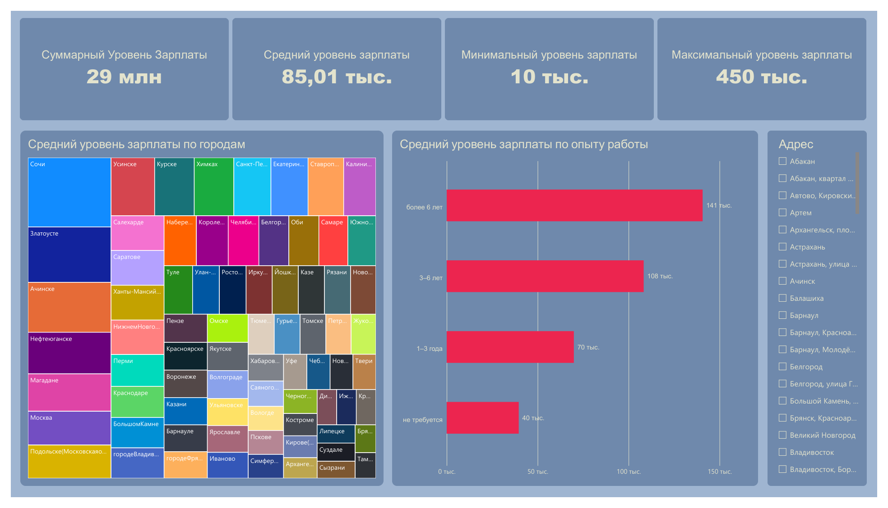
*Страница 1 — Заработная плата*

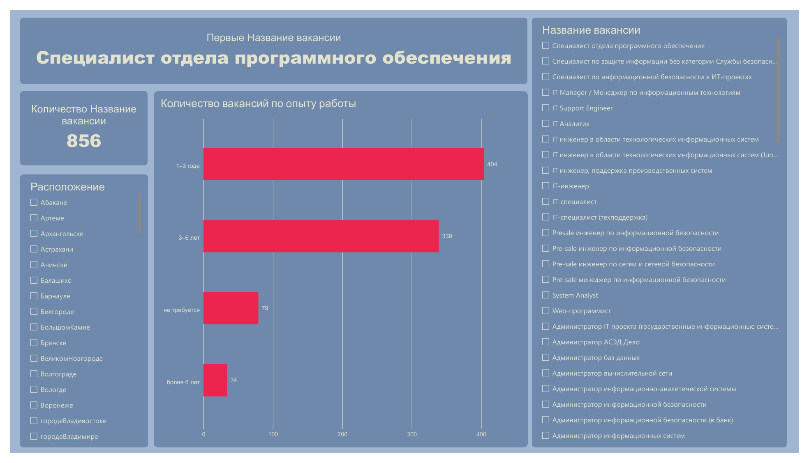
*Страница 2 — Вакансии*

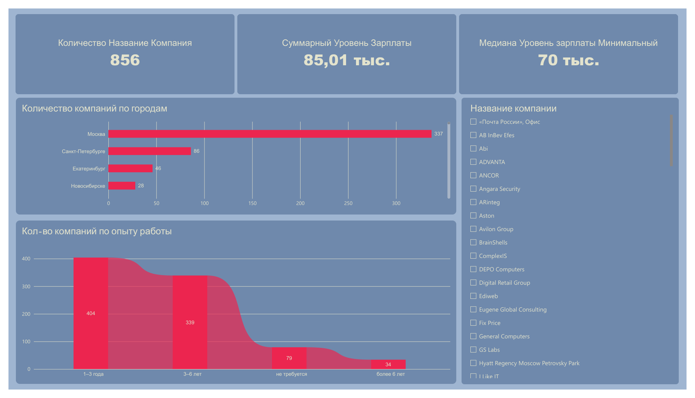
*Страница 3 — Компании*

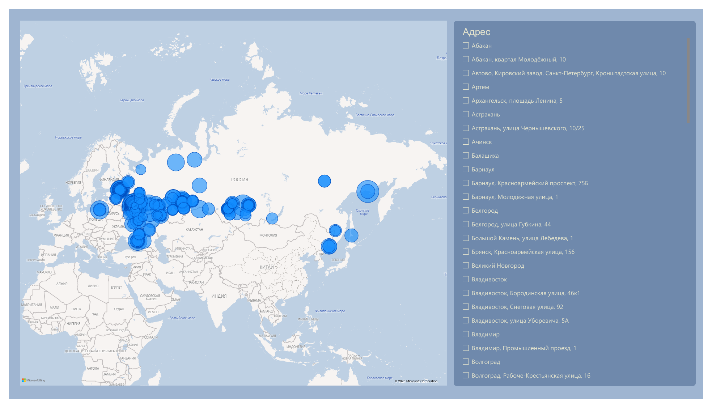
*Страница 4 — Карты*

### Файлы проекта
* Исходные материалы и PDF-отчет представлены в директории [`/lab1`](./lab1/).

---

## 2. Детализация вакансий и условий работы

Анализ условий выплат, формата занятости (удаленная работа) и географии вакансий.

### Визуализация дашборда
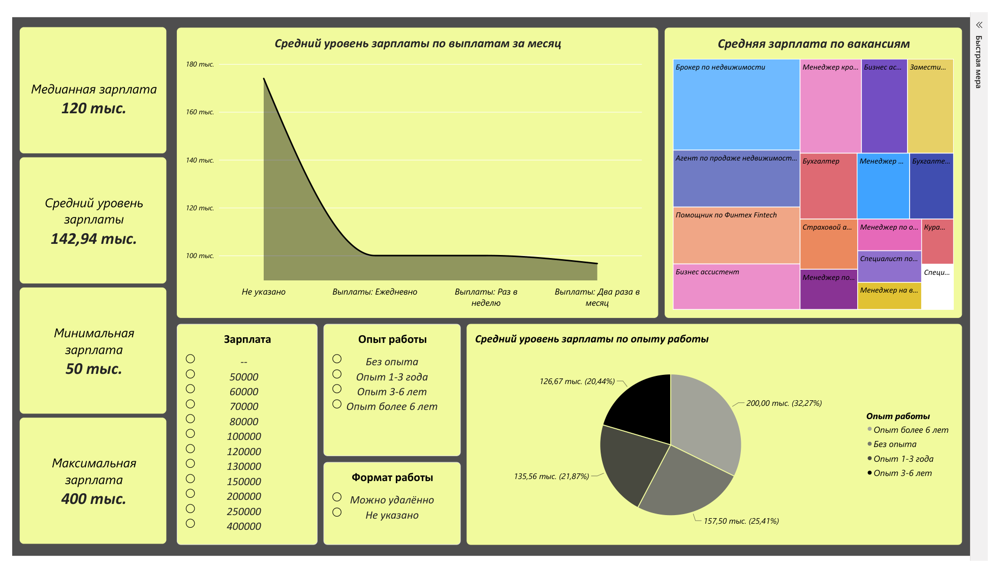
*Страница 1 — Заработная плата*

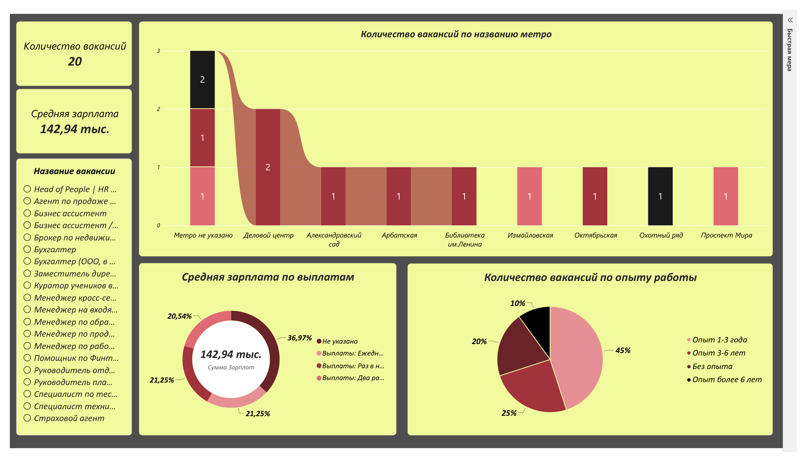
*Страница 2 — Вакансии*

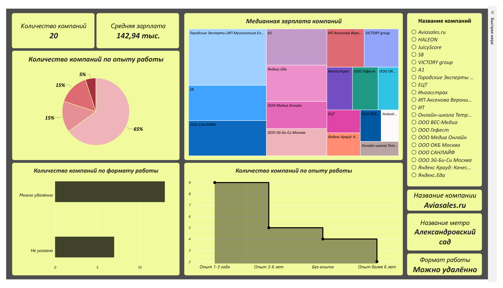
*Страница 3 — Компании*

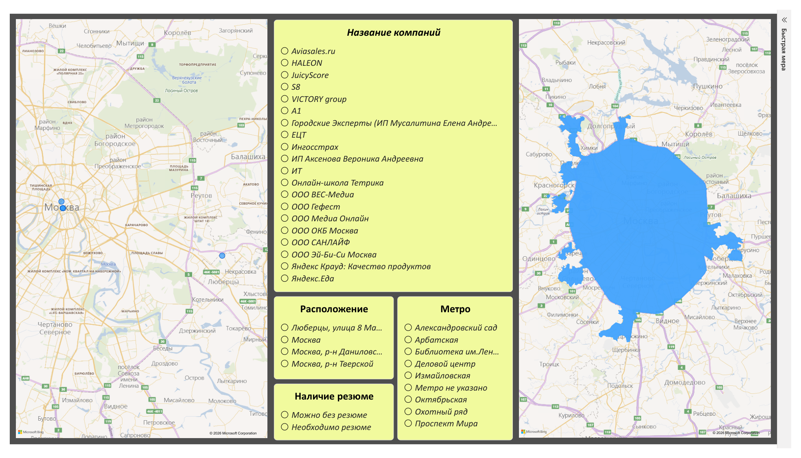
*Страница 4 — Карты*

### Файлы проекта
* Исходные материалы и PDF-отчет представлены в директории [`/lab2`](./lab2/).

---

## 3. Мониторинг социальных сетей и медиапотока

Анализ медиаданных, тональности публикаций, просмотров и вовлеченности аудитории.

### Визуализация дашборда
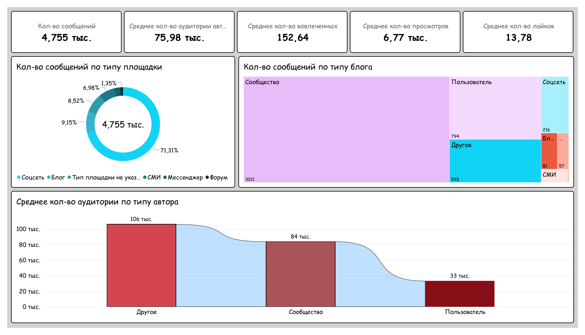
*Страница 1 — Обзор*

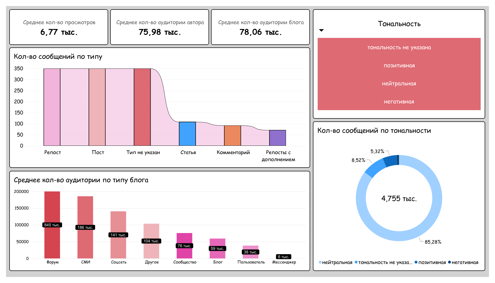
*Страница 2 — Анализ мнений*

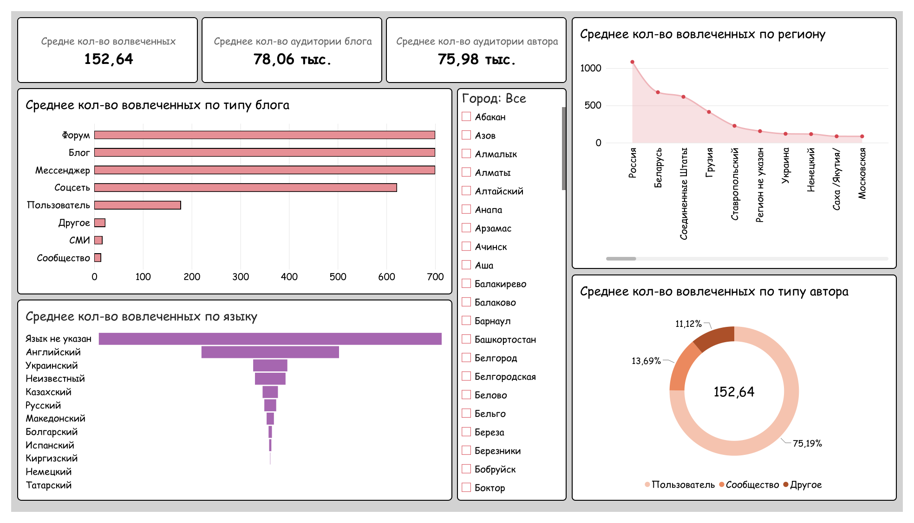
*Страница 3 — Вовлеченность аудитории*

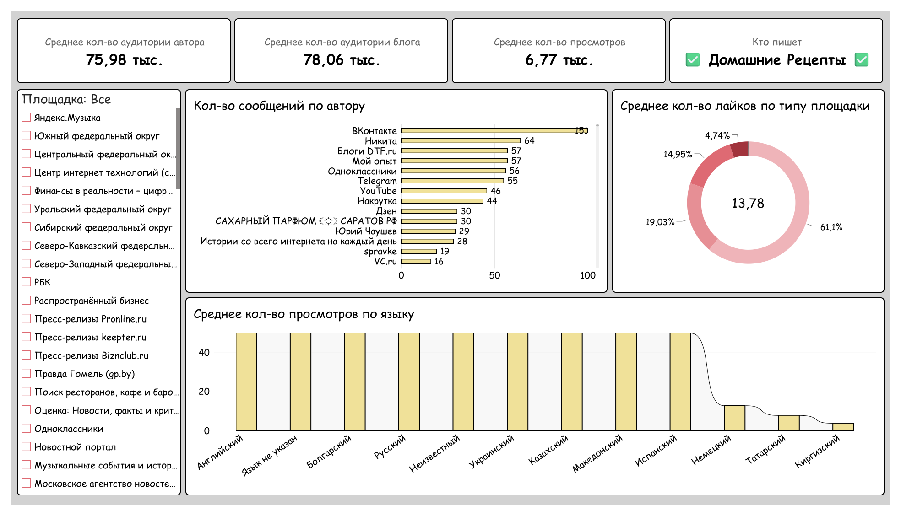
*Страница 4 — Источники и аудитория*

### Файлы проекта
* Исходные материалы и PDF-отчет представлены в директории [`/lab3`](./lab3/).

---

*Примечание: Исходные файлы отчетов (`.pdf`) и проекты Power BI (`.pbix`) находятся в соответствующих папках.*
